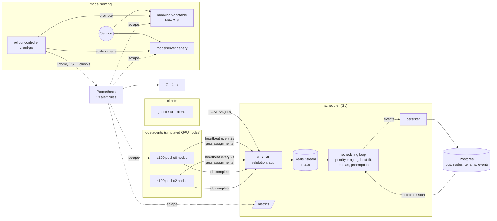
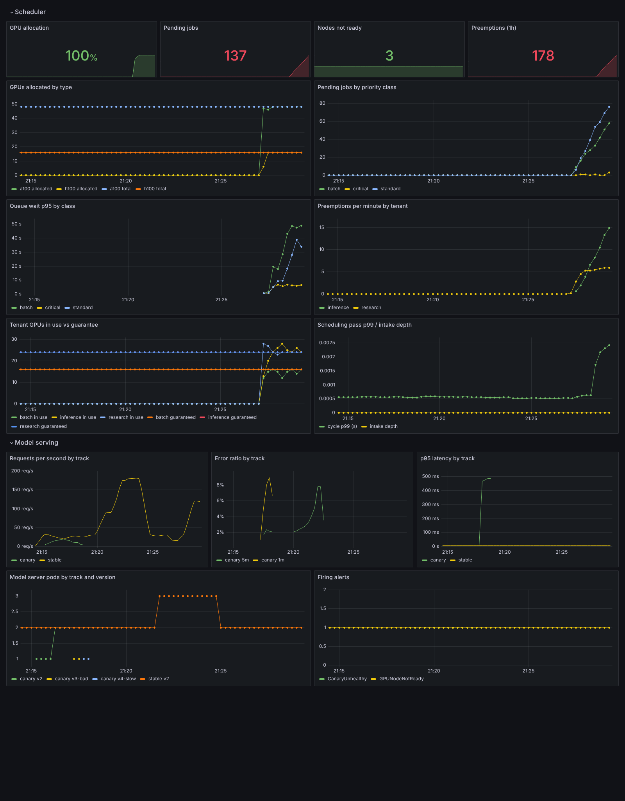

# gpu-scheduler-platform

[](https://github.com/Samarateja0118/gpu-scheduler-platform/actions/workflows/ci.yml)

A GPU job scheduler and model-serving platform in Go on Kubernetes. A control plane packs GPU jobs onto nodes with priorities, preemption, per-tenant quotas and isolated node pools. A model server ships through a canary that rolls itself back when it breaks its SLO. Prometheus, Grafana, Helm, Terraform/OpenTofu, Ansible and GitHub Actions cover monitoring, packaging, provisioning and CI/CD.

**Read this first: the GPUs are simulated.** A "node" is a goroutine in a node-agent pod that advertises 8 GPUs and "runs" a job by waiting out its runtime. The scheduling logic, API, persistence, failure handling, rollout controller and Kubernetes deployment are real and tested. Nothing touches CUDA or a device plugin. Every number below says how it was measured.

## Architecture



| Component | What it does | Code |
|---|---|---|
| Scheduler core | Placement, priority queue with aging, quotas, preemption, pools, node expiry | [`internal/scheduler`](internal/scheduler) |
| Control plane | REST API, Redis intake consumer, Postgres persister, scheduling and expiry loops | [`internal/controlplane`](internal/controlplane), [`cmd/scheduler`](cmd/scheduler) |
| Node agent | Simulates N GPU nodes per pod: heartbeat, run assigned jobs, stop withdrawn ones | [`cmd/nodeagent`](cmd/nodeagent) |
| Simulator | Replays identical 72h job traces through each policy on a virtual clock | [`internal/sim`](internal/sim), [`cmd/simbench`](cmd/simbench) |
| Model server | CPU-bound MLP per request so the HPA reacts to real load; fault injection | [`cmd/modelserver`](cmd/modelserver) |
| Rollout controller | Canary steps, PromQL SLO analysis, rollback or promote | [`internal/rollout`](internal/rollout), [`cmd/rollout`](cmd/rollout) |
| Load generator | Open-loop stepped load, per-step latency percentiles | [`cmd/loadgen`](cmd/loadgen) |
| Deploy | Helm chart, alert rules, Grafana dashboard | [`deploy/helm`](deploy/helm/gpu-scheduler) |
| Provisioning | OpenTofu/Terraform (kind + Helm), Ansible (host to running lab) | [`infra/`](infra) |
| CI/CD | Tests on real Postgres/Redis, manifest checks, images to GHCR, kind e2e | [`.github/workflows/ci.yml`](.github/workflows/ci.yml) |

## Scheduling model

A job asks for N whole GPUs on one node, an optional GPU type, a priority class (`batch` 100, `standard` 500, `critical` 1000) and a runtime. Critical jobs are non-preemptible by default.

- **Queue order.** Highest effective priority first, then submission time. Effective priority adds +25 for every 10 minutes waited, capped at +300, so old batch work eventually overtakes newer standard work. Aging changes order only. Preemption always uses base priority so aging cannot cause eviction loops.
- **Placement.** Best-fit: the node left with the fewest free GPUs, which keeps whole nodes free for 8-GPU jobs. Inside a node, GPUs are grouped into 4-GPU interconnect islands (NVLink-style) and a job that fits in one island stays in one. First-fit and spread are available for comparison.
- **Quotas.** Each tenant has `guaranteed` and `max` GPUs. Usage above the guarantee is *borrowed*, and the newest running jobs are the borrowed ones. A tenant at `max` waits, or displaces its own lower priority work.
- **Preemption rules.**
  - Non-preemptible jobs are never evicted.
  - Within a tenant, only strictly lower priority jobs can be evicted.
  - Across tenants, only *borrowed* jobs can be evicted. That happens when the preemptor is reclaiming its own guarantee, or when it outranks the victim.
  - Among nodes that work, the scheduler picks the cheapest victim set: lowest maximum victim priority, then fewest victims, then least work thrown away.
  - Evicted jobs restart from zero. There is no checkpointing.
- **Isolation.** A tenant with a `pool` runs only on nodes in that pool, and pool nodes run only that tenant. On top of that, each GPU belongs to exactly one job (no fractional sharing). NetworkPolicies limit Postgres and Redis to the scheduler pods.
- **Failure handling.** A node that misses heartbeats for 15s is marked NotReady and its jobs are requeued. Agents learn about preemption or cancellation on their next heartbeat, when the job is missing from their assignment list.
- **Durability.** Every state change is written to Postgres in order, in one transaction with an audit event. On start the scheduler rebuilds its memory from Postgres, re-binds running jobs to their recorded GPUs, and gives agents a grace period to reconnect. Submissions go through a Redis Stream consumer group and are acknowledged only after admission. Unacknowledged entries are redelivered after a crash, and job IDs make redelivery idempotent.

## Results

### 1. Policy comparison (simulator, 128 simulated GPUs)

`go run ./cmd/simbench -seeds 5 -hours 72 -loads 0.7,0.85,1.0`. Setup: 16 nodes x 8 GPUs (12 a100, 4 h100). Three tenants: inference (35% of load, diurnal, 70% critical, guarantee 48), research (40%, up to 8-GPU jobs, 15% need h100, guarantee 48) and batch (25%, guarantee 32). Lognormal runtimes with medians of 20 to 45 minutes. Each cell is the mean of 5 random traces, and all policies see identical traces. Full tables are in [`results/simbench/results.md`](results/simbench/results.md).

At offered load 1.0 (the cluster is asked for exactly its capacity):

| policy | useful GPU util | critical p95 wait | batch p95 wait | 8-GPU p95 wait | preemptions | work lost to preemption | guarantee shortfall |
|---|---|---|---|---|---|---|---|
| FIFO, first-fit | **96.1%** | 142.8 min | **326.8 min** | **478.9 min** | 0 | 0 | 990 GPU-h |
| priority + aging, best-fit, no preemption | 92.3% | 13.1 min | 1284 min | 1783 min | 0 | 0 | 924 GPU-h |
| **priority + aging, best-fit, preemption + quotas (default)** | 86.9% | **2.9 min** | 1505 min | 2448 min | 3014 | 9.0% | **585 GPU-h** |
| same, spread placement | 85.7% | 2.6 min | 1800 min | 2773 min | 2900 | 8.4% | 712 GPU-h |

What this shows, including where the default loses:

- The default cuts critical p95 queue wait from 142.8 to 2.9 minutes (about 49x). It cuts the GPU-hours tenants were owed under their guarantee but did not get by 41% (990 to 585).
- It pays for that. About 9% of delivered GPU-hours are thrown away by preemption because jobs restart from zero. Useful utilization falls from 96.1% to 86.9%. Batch and 8-GPU jobs wait far longer. **FIFO has the best useful utilization at full load.** Checkpoint-and-resume (see "At scale") is the obvious fix and is not built.
- Best-fit beats spread at every load. At load 0.85, spread leaves 11.5% of GPUs idle while jobs are queued, against 6.3% for best-fit, and 8-GPU p95 wait is 851 against 380 minutes.
- At load 0.7 every policy keeps critical p95 wait under 1.5 minutes. The trade-offs only show under contention.

"Guarantee shortfall" counts GPU-hours where a tenant had pending demand within its guarantee but held fewer GPUs than that. It includes demand that could not fit on any single node because of fragmentation or GPU type, so it is never zero.

### 2. Scheduling pass cost (Go benchmark)

`go test -bench . ./internal/scheduler/`, 4-vCPU cloud VM:

| case | time per pass |
|---|---|
| 100 nodes, 1,000 pending, from empty | 7.9 ms |
| 500 nodes (4,000 GPUs), 5,000 pending, from empty | 156 ms |
| 500 nodes, cluster full, ~4,000 still pending (typical steady state) | 5.0 ms |

The first version took 690 ms for the steady-state case, because it retried placement and preemption for every pending job. Caching failures by job shape (tenant, priority, GPU count, GPU type) within a pass brought it to 5 ms. The cache is invalidated on a bind (for preemption) or an eviction (for placement). The simulator output is identical before and after.

### 3. Live cluster: failure scenarios

[`scripts/e2e-scheduler.sh`](scripts/e2e-scheduler.sh) ran on a single-node k3s cluster (Kubernetes v1.31). The chart was deployed with 8 simulated nodes (64 GPUs) across two node-agent pools, Postgres and Redis. The script submits 150 jobs at 5/s with the simulator's mix (runtimes scaled to seconds). Twelve seconds in it deletes a node-agent pod (3 nodes, 24 GPUs). About 25 seconds later it deletes the scheduler pod.

| measured | result |
|---|---|
| jobs that reached Succeeded | **150 / 150** |
| running jobs restored from Postgres after the scheduler pod was killed | 40 (no restart of those jobs) |
| jobs requeued after their node stopped heartbeating | 15 |
| preemptions during the run | 81 |

Log: [`results/e2e/log.txt`](results/e2e/log.txt). CI runs the same script on kind with 80 jobs.

### 4. Live cluster: canary rollouts

[`scripts/e2e-canary.sh`](scripts/e2e-canary.sh) ran on the same k3s cluster. An in-cluster load generator sends a steady 40 req/s to the model server Service. Three releases go through `rollout` with steps of 25% and 50%, 60s per step and a check every 15s. The SLO is at most 2% 5xx and p95 at most 250ms over a 1-minute window, and two consecutive breaches abort. Faults are injected with environment variables on the canary.

| release | injected fault | outcome | time to decision | reason recorded |
|---|---|---|---|---|
| v2 | none | **promoted** (8/8 checks passed, canary p95 4.75ms) | 2m6s | all steps within SLO |
| v3-bad | 15% of requests return 500 | **rolled back** at the 25% step | 32s | error rate 14.12% > 2.00% |
| v4-slow | +400ms per request | **rolled back** at the 25% step | 32s | p95 488ms > 250ms |

Over the 30-minute run, the stable track served 12,480 requests with 0 errors. The bad release served 792 requests (127 errors) before it was removed. The slow release served 719. After the run, stable is on v2 and the canary is scaled to 0. Raw output is in [`results/canary/`](results/canary).

The first run of this script found a real bug. Analysis queries matched `track="canary"` only, so errors from the rolled-back v3 that were still inside the 1-minute window were charged to v4. v4 was then rolled back for the wrong reason ("error rate 9.13%"). The SLO queries are now scoped to the release's `version` label, and v4 is rejected for its latency.

### 5. Live cluster: autoscaling under load

[`scripts/loadtest-hpa.sh`](scripts/loadtest-hpa.sh) runs an open-loop load generator inside the cluster against the model server Service in steps (30, 120, 360 and then 30 req/s). It samples the HPA every 10s. Each request runs a 32-layer 128x128 MLP on the CPU, which is about 1 ms of CPU. Pods request 100m CPU, and the HPA targets 60%, with min 2 and max 8 replicas.

| step | req/s achieved | p50 | p95 | p99 | errors | replicas |
|---|---|---|---|---|---|---|
| 0-60s | 30.0 | 1.8 ms | 2.8 ms | 4.5 ms | 0 | 2 |
| 60-150s | 120.0 | 1.6 ms | 2.4 ms | 3.7 ms | 0 | 2 (CPU 59% of request) |
| 150-300s | 360.0 | 1.6 ms | 2.8 ms | 4.8 ms | 0 | 2 → 4 → **6** |
| 300-450s | 30.0 | 1.9 ms | 2.8 ms | 4.6 ms | 1 | 6 → 5 → 4 → 3 |

- Scale-up: the load stepped to 360 req/s at t=150s. The HPA wanted 4 pods at t=182s and 6 at t=193s, and 6 were serving by t=213s, about 63 seconds after the step. CPU peaked at 164% of the request during the lag, then settled at 63% on 6 pods. p95 latency stayed under 3 ms throughout, because the CPU limit (500m) leaves headroom above the request.
- Scale-down follows the configured 60s stabilization window and then 1 pod per 30s: 6 to 3 between t=376s and t=447s.
- 1 error in 70,803 requests, during scale-down. It is most likely a connection to a terminating pod (no preStop delay is configured), but that was not confirmed.
- Raw data: [`results/hpa/`](results/hpa). A smaller run at 180 req/s (2 → 3 replicas) is in [`results/hpa-180/`](results/hpa-180).

All of this ran on one 4-vCPU VM next to the rest of the stack. It shows the autoscaling loop working, not production capacity.



*The provisioned Grafana dashboard, captured live. The canary error spike (v3-bad) and latency spike (v4-slow) are visible, as are pods by version, the HPA scale-up to 3 during the 180 req/s run, and a scheduler workload running at 100% GPU allocation with preemptions. "Nodes not ready: 3" is the agent pod killed in the failure test. Those dead node entries are never garbage-collected (listed under limits).*

## Failure cases and known limits

| scenario | what happens | where it is tested |
|---|---|---|
| Node agent dies | Its nodes go NotReady after 15s and their jobs requeue with `requeues+1`. The dead node names stay listed as NotReady (no garbage collection yet). | unit test `TestNodeExpiryRequeues`, cluster e2e |
| Scheduler pod dies | Deployment `Recreate`. The new pod restores from Postgres. Unacknowledged Redis entries are redelivered, and duplicates are ignored by job ID. Nothing is scheduled while it is down (single replica). | integration test `TestLifecycleAndRestart`, cluster e2e |
| Postgres slow or down | The event channel buffers 50k events and then blocks scheduling on purpose, so that state is never silently lost. The `SchedulerPersistenceBacklog` alert fires at 1k. Readiness fails. | not fault-injected |
| Redis down | Submissions return 503. Running work is unaffected. | not fault-injected |
| Completion report lost | The agent retries 10 times. If it never arrives the job holds its GPUs until the node expires. A late duplicate is a no-op. | unit test (idempotency) |
| Large-job starvation | No reservations or backfill, so small jobs keep overtaking 8-GPU jobs. Aging helps ordering, not fragmentation. Measured above (8-GPU p95). | simulator |
| Preemption waste | Restart from scratch, about 9% of GPU-hours at full load. | simulator |
| Bad canary | Two consecutive SLO breaches roll it back. A canary that gets no traffic is a failure, not a pass. If promotion fails, the stable image is reverted. | unit tests, cluster e2e |
| Canary traffic split | Replica-ratio, so 25% is approximate and depends on pod counts. No mesh-level weights. | design choice |
| Over-quota high priority job | Can displace only its own tenant's lower priority work, and only on one node. | unit test `TestQuotaMaxHoldsJobs` |

## What I would do at scale

- **HA control plane.** Run two or more replicas with leader election through a Kubernetes Lease, or move placement into a real `kube-scheduler` plugin or Kueue. Shard queues by GPU pool so one pass never scans the whole cluster.
- **Real GPUs.** NVIDIA device plugin or DRA (Dynamic Resource Allocation) for allocation. DCGM exporter for utilization, memory and XID errors. Topology from NVML instead of fixed 4-GPU islands. MIG or time-slicing for inference.
- **Gang scheduling and reservations.** Multi-node jobs placed all-or-nothing with topology awareness (same rack or spine). Reserve capacity for blocked large jobs and backfill around them, to fix the starvation the simulator shows.
- **Checkpoint-aware preemption.** Signal the job, wait for a checkpoint, then evict. Count lost work as time since the last checkpoint. That recovers most of the 9% waste.
- **Fair share over time.** Dominant-resource fairness or decayed historical usage instead of static guarantees.
- **Durability at volume.** Batch event writes, partition the events table by time, and keep only the latest job row hot. Postgres with a managed HA setup.
- **Serving.** Weighted routing (Gateway API or a mesh) for exact canary percentages. Autoscale on queue depth or tokens per second rather than CPU. Multi-window burn-rate alerts that are already in the rules, wired to paging.
- **Multi-cluster.** A global queue that routes jobs to regional clusters by capacity, data locality and price.

## Running it

```bash
# tests (Postgres/Redis tests run when these are set)
DATABASE_URL=postgres://postgres@localhost:5432/gpusched REDIS_ADDR=localhost:6379 go test -race ./...

# policy comparison and pass-time benchmarks
go run ./cmd/simbench -seeds 5 -hours 72 -loads 0.7,0.85,1.0 -out results/simbench
go test -run '^$' -bench . ./internal/scheduler/

# cluster: kind + Helm via OpenTofu/Terraform ...
cd infra/terraform && tofu init && tofu apply
# ... or a whole lab host via Ansible
cd infra/ansible && ansible-playbook site.yml
# ... or Helm directly
helm upgrade --install gs deploy/helm/gpu-scheduler -n gpusched --create-namespace

# scenarios
./scripts/e2e-scheduler.sh     # workload + node loss + scheduler restart
./scripts/e2e-canary.sh        # healthy promote, error and latency rollbacks
./scripts/loadtest-hpa.sh      # stepped load, HPA replica trace

# API
export SCHEDULER_URL=http://localhost:8080 API_TOKEN=...
gpuctl submit -tenant research -priority standard -gpus 4 -runtime 120
gpuctl cluster
```

API: `POST /v1/jobs`, `GET /v1/jobs[/{id}]`, `DELETE /v1/jobs/{id}`, `POST /v1/jobs/{id}/complete`, `POST /v1/nodes/{name}/heartbeat`, `POST /v1/nodes/{name}/cordon`, `GET /v1/nodes`, `GET|PUT /v1/tenants[/{name}]`, `GET /v1/cluster`, `/healthz`, `/readyz`, `/metrics`. Mutating calls need `Authorization: Bearer $API_TOKEN`.

## How this was verified, and what was not

- Unit tests: 16 scheduler tests, including a 2,000-step randomized invariant test (no double-allocated GPU, usage matches allocations, no cross-tenant preemption of guaranteed work, no eviction of non-preemptible jobs). 6 rollout controller tests. API validation and auth tests.
- Integration test against real Postgres 16 and Redis 7: submit, bind, preempt, complete, restart, restore, requeue on node timeout.
- Live cluster runs were on **k3s v1.31 on one 4-vCPU VM**, not kind. kind's nested container runtime does not start in the sandbox this was built in. The CI workflow runs the same scripts on kind (v1.31) on GitHub-hosted runners, and they pass there. In the first green run: 80/80 jobs succeeded through both failure injections, v2 was promoted, and v3-bad (18.3% errors) and v4-slow (p95 488ms) were each rolled back in 32s.
- `tofu apply` in existing-cluster mode deployed the whole stack to k3s in 16s. The scheduler e2e script then passed against that deployment (40/40 jobs through both failure injections). The kind-creation path of the Terraform was validated, not applied, locally.
- The Ansible playbook passes `ansible-playbook --syntax-check` and `ansible-lint` (production profile). It has not been run against a fresh host.
- Not done: real GPUs, multi-node clusters, HA scheduler, load beyond one VM.
